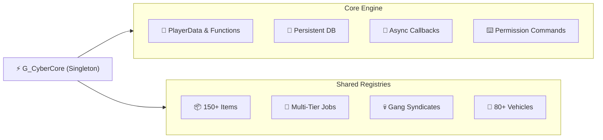

<div align="center">

  

  # G-CyberRPcore

  **The Definitive, Modular Roleplay Framework for Cyberpunk 2077 (CyberMP)**
  
  *Pioneering the Next Generation of Multiplayer Roleplay in Night City — Inspired by QBCore.*

  [](https://cyber.mp)
  [](https://developer.mozilla.org/en-US/docs/Web/JavaScript)
  [](https://github.com/G-CyberRPcore)
  [](https://opensource.org/licenses/MIT)

</div>

---

## ⚡ What is G-CyberRPcore?

**G-CyberRPcore** is an ambitious, community-driven roleplay framework engineered from the ground up specifically for the newly released **CyberMP** multiplayer mod for *Cyberpunk 2077*.

Drawing heavy inspiration from **QBCore** (the industry-standard FiveM framework), G-CyberRPcore provides a comprehensive, production-ready, and extensible foundation for server developers.

---

## 💎 Features

* **Unified `PlayerData` Structure:** Every connected citizen possesses persistent identity data (`citizenid`, `charinfo`, `money`, `job`, `gang`, `metadata`, and `inventory`).
* **Universal Callback Engine:** Native support for asynchronous Request/Response handling (`CreateCallback` / `TriggerCallback`) across Server, Client, and CEF.
* **150+ Cyberpunk Items:** Giant pre-configured item library (`Shared.Items`) containing medical stims, weapons, ammo, cyberware operating systems (Sandevistan, Cyberdecks), tools, and consumables.
* **Multi-Tier Careers & Factions:** Fully structured legal careers (`Shared.Jobs`) such as NCPD, Trauma Team, Ripperdocs, and Delamain Taxi with grades, salaries, and on-duty toggles.
* **Night City Gangs & Syndicates:** Built-in gang system (`Shared.Gangs`) covering the Valentinos, Maelstrom, Tyger Claws, The Mox, 6th Street, and Aldecaldos.
* **80+ Vehicle Catalog:** Pre-indexed vehicle library with TweakDB IDs, CName appearance skins, trunk weight limits, and showroom pricing.
* **Virtual Dimensions Housing:** Zero-collision instanced apartments utilizing CyberMP's native dimensions (`player.dimension`).
* **Zero Boilerplate:** Extend the framework with your own modules using clean exports.

---

## 🏗️ Architecture



---

## 🚀 Quick Start for Server Owners

1. Place `G-CyberRPcore` inside your server's `resources` directory:
   ```text
   resources/
   └── G-CyberRPcore/
   ```
2. Enable it in your `server.toml`:
   ```toml
   resources = [
     "G-CyberRPcore"
   ]
   ```
3. Run your CyberMP Server:
   ```powershell
   .\cybermp-server.exe -run
   ```

---

## 📖 Developer Documentation

For complete function signatures, player methods, callback usage, and event structures, see [**docs/API.md**](./docs/API.md).

---

## 🛡️ License

This project is licensed under the **MIT License** — open-source, permissive, and built for the community.
