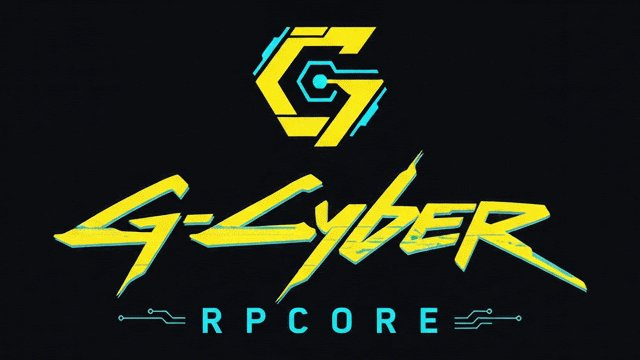

<div align="center">

  

  # G-CyberRPcore
  ### The Definitive Modular Roleplay Framework for Cyberpunk 2077 (CyberMP)

  *Pioneering the Next Generation of Multiplayer Roleplay in Night City — Inspired by QBCore & txAdmin.*

  [](https://cyber.mp)
  [](https://developer.mozilla.org/en-US/docs/Web/JavaScript)
  [](https://github.com/G-CyberRPcore)
  [](http://localhost:2078)
  [](https://github.com/G-CyberRPcore/G-CyberRPcore)
  [](https://opensource.org/licenses/MIT)

</div>

---

## ⚡ Overview & Vision

**G-CyberRPcore** is an enterprise-grade, community-driven roleplay framework engineered specifically for **CyberMP** on REDengine (*Cyberpunk 2077*). 

Inspired by the decoupled resource architecture of FiveM's **QBCore** and the integrated server administration capabilities of **txAdmin**, G-CyberRPcore provides an extensible, production-ready foundation for Night City roleplay servers with automated ecosystem deployment, cross-platform CLI management, a resilient database abstraction layer, and native REDengine game integration.

---

## 🌐 Modular Ecosystem & Architecture

G-CyberRPcore follows a decoupled, plug-and-play architecture where game systems exist as independent GitHub repositories under the **[G-CyberRPcore](https://github.com/G-CyberRPcore)** organization. Each resource contains its own configuration and UI while communicating with the master core via the global runtime `global.G_CyberCore`:

```
[CyberMP Server Root]
├── cybermp-server.exe (v4.0.5-beta.2+)
├── server.toml (Configured with G-CyberRPcore)
├── gcyber.bat (Windows CLI Orchestrator)
├── gcyber.sh  (Linux CLI Orchestrator)
└── resources/
    ├── G-CyberRPcore/           <- Master Core Framework & Admin Engine
    │   ├── tools/               <- gcyber-deploy.ps1 & gcyber-deploy.sh
    │   ├── core/                <- DAL, Player class, Commands, Admin Server
    │   └── shared/              <- Shared Items, Jobs, Gangs, Vehicles
    ├── gcyber-loading/          <- Neural Loading Screen & Equalizer
    ├── gcyber-hud/              <- Circular Survival Dials & Speedometer
    ├── gcyber-multicharacter/   <- 4-Slot Identity Selector & 3D Studio
    └── chat/                    <- Proximity RP Chat Engine
```

### Official Ecosystem Resources

| Resource | Description | Repository |
| :--- | :--- | :--- |
| **`G-CyberRPcore`** | **Master Core Framework**: Central engine, unified DB abstraction layer, player entity classes, session manager, and the `G-CyberAdmin` web panel. | [G-CyberRPcore/G-CyberRPcore](https://github.com/G-CyberRPcore/G-CyberRPcore) |
| **`gcyber-loading`** | **Neural Loading Screen**: Immersive loading interface featuring live Web Audio API equalizer, canvas cyber-grid, server telemetry badges, and OST audio controls. | [G-CyberRPcore/gcyber-loading](https://github.com/G-CyberRPcore/gcyber-loading) |
| **`gcyber-hud`** | **Cyberpunk HUD & Metabolism**: High-tech circular SVG dials (Health, Armor, Hunger, Thirst, Stress), dynamic spatial voice waveform, and vehicle speedometer. | [G-CyberRPcore/gcyber-hud](https://github.com/G-CyberRPcore/gcyber-hud) |
| **`gcyber-multicharacter`** | **3D Multicharacter & Studio**: 4-slot playable identity selector, in-game identity termination modal, and native REDengine 3D Character Creator launcher. | [G-CyberRPcore/gcyber-multicharacter](https://github.com/G-CyberRPcore/gcyber-multicharacter) |
| **`chat`** | **Proximity Spatial Chat**: 3D spatial local speech, roleplay action commands (`/me`, `/do`, `/ooc`, `/shout`), and system broadcast notifications. | Included with CyberMP |

---

## 🛠️ Prerequisites & Requirements

Before installing G-CyberRPcore, ensure your host environment meets the following specifications:

1. **CyberMP Dedicated Server**: v4.0.5-beta.2 or newer ([Official CyberMP](https://cyber.mp)).
2. **Git**: Installed and available in system `PATH` (used for auto-deployment and updates).
3. **Node.js**: v18.0.0+ LTS recommended on the host system (the game server executable also embeds `libnode.dll`).
4. **Database (Dual Mode)**:
   * **Production**: MariaDB / MySQL server on port `3307` or `3306`.
   * **Zero-Config Fallback**: SQLite 3 (automatically handled by `node:sqlite` without external software).
5. **Operating System**:
   * **Windows**: Windows 10/11 or Windows Server 2019/2022.
   * **Linux**: Ubuntu 20.04+, Debian 11+, or Arch Linux (via Wine/Proton 8.0+ for running `cybermp-server.exe`).

---

## 🚀 Installation Guide (Windows & Linux)

### Option 1: Automated Deployment (Recommended)

The automated deployer inspects your environment, clones all official decoupled resources, configures dependencies, validates database readiness, and performs syntax verification automatically.

#### 🪟 Windows Setup

1. **Clone G-CyberRPcore** into your server's `resources/` directory:
   ```cmd
   cd \path\to\cybermpserver\resources
   git clone https://github.com/G-CyberRPcore/G-CyberRPcore.git G-CyberRPcore
   ```

2. **Copy the CLI launcher** to your server root (or run directly from `tools`):
   ```cmd
   copy resources\G-CyberRPcore\tools\gcyber.bat .\gcyber.bat
   copy resources\G-CyberRPcore\tools\gcyber-deploy.ps1 .\gcyber-deploy.ps1
   ```

3. **Run the Auto-Deployer**:
   ```cmd
   .\gcyber.bat deploy
   ```
   *The script will automatically clone `gcyber-loading`, `gcyber-hud`, and `gcyber-multicharacter`, install npm packages, create `database/` and `cache/`, and verify your configuration.*

4. **Verify Syntax & Start Server**:
   ```cmd
   .\gcyber.bat test
   .\gcyber.bat start
   ```

---

#### 🐧 Linux Setup (Ubuntu / Debian / CentOS / Arch)

Running a CyberMP dedicated server on Linux operates smoothly using Wine or Proton.

1. **Clone G-CyberRPcore** into `resources/`:
   ```bash
   cd /path/to/cybermpserver/resources
   git clone https://github.com/G-CyberRPcore/G-CyberRPcore.git G-CyberRPcore
   ```

2. **Copy and activate the Linux CLI Orchestrator**:
   ```bash
   cd /path/to/cybermpserver
   cp resources/G-CyberRPcore/tools/gcyber-deploy.sh ./gcyber.sh
   chmod +x ./gcyber.sh
   ```

3. **Run the Auto-Deployer**:
   ```bash
   ./gcyber.sh deploy
   ```
   *Clones all ecosystem repositories, verifies SQLite/MySQL connectivity, and installs npm modules.*

4. **Validate Code & Diagnostics**:
   ```bash
   ./gcyber.sh status
   ./gcyber.sh test
   ```

5. **Launch Server on Linux**:
   ```bash
   wine cybermp-server.exe -run
   ```
   *(Or run within a `systemd` service or tmux session).*

---

### Option 2: Manual Installation

If you prefer to manually organize resources without running the deployer script:

```bash
cd cybermpserver/resources
git clone https://github.com/G-CyberRPcore/G-CyberRPcore.git G-CyberRPcore
git clone https://github.com/G-CyberRPcore/gcyber-loading.git gcyber-loading
git clone https://github.com/G-CyberRPcore/gcyber-hud.git gcyber-hud
git clone https://github.com/G-CyberRPcore/gcyber-multicharacter.git gcyber-multicharacter

# Install core production dependencies
cd G-CyberRPcore
npm install --production
```

---

## 🔧 Vanilla CyberMP Server Modifications

To ensure **G-CyberRPcore** operates with maximum stability and performance, the following specific settings in the original vanilla `cybermp-server` files must be configured:

### 1. `server.toml` (Primary Configuration)

Edit `server.toml` in your server root directory to reflect the required roleplay parameters:

```toml
#:schema https://schemas.cyber.mp/server/schema.json

# Network Host & Port Binding
tcp_host = "0.0.0.0:2077"
udp_host = "0.0.0.0:2077"
max_players = 64

# Registered Active Resources
# Note: G-CyberRPcore acts as the master coordinator.
resources = [
  "G-CyberRPcore"
]

disable_voice = false
cef_debug = false
ep2_dlc_enabled = false
duplicatePlayers = 50

[core]
nametags = true
death_autostand = false                    # CRITICAL: Prevents instant auto-respawn to enable medical RP & revival
disable_switch_seats = true
default_gameplay_restrictions = true
disable_drop_points = true                 # Disables singleplayer drop points
disable_location_dependent_quests = true
disable_garage = true                      # CRITICAL: Disables native car spawning to let RP garage manage vehicles
delete_map_objects = true
files = [
  "final.redscripts",
  "new_gamedef.archive",
  "basegame_no_intro_videos.archive",
  "CyberMP_PlayerModel.archive",
  "flatline2dlods.archive",
  "ReducedLoot.archive",
  "ReducedLoot.archive.xl",
  "GenderAbuseWorld.archive",
  "ArchiveXL"
]

[core.overrides]
change_player_on_death_logic = true        # Required for Trauma Team / RP medical handling
disable_side_quests_notifications = true
change_vehicles_logic = true               # Enables custom vehicle ownership & persistence
disable_player_inventory_encumbrance = true
player_extended_customization = true       # Unlocks full character customization
disable_time_skip = true
disable_turrets = true
disable_surveillance_cameras = true
disable_vending_machines = true
disable_generic_devices = true
disable_no_combat = true                   # Allows realistic combat zones in city areas
```

### 2. Network Firewall & Port Allocation

Ensure the following ports are open in your server firewall (Windows Defender Firewall or Linux `ufw` / `iptables`):

| Port | Protocol | Service | Description |
| :--- | :--- | :--- | :--- |
| **`2077`** | **TCP & UDP** | CyberMP Server | Main multiplayer game protocol & client synchronizer. |
| **`2078`** | **TCP** | G-CyberAdmin | HTTP & SSE Web Management Dashboard for server admins. |
| **`3307`** (or 3306) | **TCP** | MariaDB / MySQL | Relational database engine (only internal/local needed). |

*On Linux with UFW:*
```bash
sudo ufw allow 2077/tcp
sudo ufw allow 2077/udp
sudo ufw allow 2078/tcp
```

### 3. Embedded V8 Runtime Constraint (`disableEval`)

REDengine's embedded Node.js runtime (`libnode.dll`) enforces the V8 flag:
`--disallow-code-generation-from-strings`

* **What this means**: Dynamic code generation via `eval()` or `new Function()` inside database drivers will trigger runtime syntax errors.
* **The Solution**: G-CyberRPcore's Database Abstraction Layer enforces `disableEval: true` mode on `mysql2` automatically, ensuring 100% stable static query parsing.

---

## 💻 `gcyber` CLI Orchestrator Reference

G-CyberRPcore includes a native CLI orchestrator (`gcyber.bat` on Windows, `gcyber.sh` on Linux) for routine operations:

```
╔═══════════════════════════════════════════════════════════════════════════════╗
║         CyberMP Dedicated Server Orchestrator & Auto-Deployer v1.0.0          ║
╚═══════════════════════════════════════════════════════════════════════════════╝
```

| Command | Action |
| :--- | :--- |
| **`gcyber status`** | Runs full pre-flight diagnostics: checks Git, Node.js, MariaDB/SQLite status, port availability (2077/2078), and repository git tracking. |
| **`gcyber deploy`** | Clones all missing ecosystem resources from GitHub, verifies `server.toml`, creates directory structures, and installs npm modules. |
| **`gcyber sync`** | Synchronizes and fast-forward pulls all ecosystem resources from GitHub to their latest `main` branch. |
| **`gcyber test`** | Strict syntax analysis (`node --check`) across all JavaScript files (26+ core and UI files) to guarantee zero runtime crashes. |
| **`gcyber clean`** | Safely terminates hanging server instances and wipes `cache/` and CEF browser cache artifacts. |
| **`gcyber start`** | Cleans caches, frees occupied ports, and launches `cybermp-server.exe -run`. |
| **`gcyber admin`** | Launches the G-CyberAdmin Web Panel directly in your default web browser on port 2078. |
| **`gcyber`** *(no args)* | Opens an interactive NetWatch terminal menu with numbered action selections. |

---

## 💾 Database Configuration (`config.js`)

Central database and framework preferences are managed via `config.js`:

```javascript
const Config = {};

// Database Configuration
Config.Database = {
  driver: 'mysql', // 'mysql' | 'sqlite'
  mysql: {
    host: '127.0.0.1',
    port: 3307,
    user: 'root',
    password: '',
    database: 'gcyberrp',
    connectionLimit: 10,
    disableEval: true // Mandatory for CyberMP V8 runtime
  },
  sqlite: {
    filePath: path.join(process.cwd(), 'database', 'gcyberrp.sqlite')
  },
  autoMigrate: true,    // Automatically creates missing SQL tables
  autoImportJson: true  // Migrates database/players.json into SQL tables
};

// G-CyberAdmin Web Management Panel
Config.AdminPanel = {
  enabled: true,
  host: '0.0.0.0',
  port: 2078,
  secretKey: 'cybermp2077'
};

// Default Spawns (Megabuilding H10 Open Atrium)
Config.Spawns = {
  default: [-1382.0, 1272.0, 123.0], // Megabuilding H10 Atrium Walkway
  hospital: [-1408.2, 1285.4, 123.0] // Trauma Team Medical Center
};
```

---

## 🎮 Gameplay Mechanics & Admin Commands

| Command / Key | Permission | Description |
| :--- | :--- | :--- |
| **`F10`** | Admin | Toggles the in-game G-CyberAdmin CEF Management Suite. |
| **`/noclip`** | Admin | Toggles 3D fly mode with multi-key descent (`Q`, `Ctrl`, `C`, `X`), sprint boost (`Shift`), and out-of-bounds GodMode kill-zone immunity. |
| **`/tpm`** | Admin | Teleports instantly to the custom waypoint placed on the world map (`gamemappinsMappinSystem`). |
| **`/heal [id]`** | Admin | Restores health to 100% and resets HUD injury effects. |
| **`/revive [id]`** | Admin | Respawns downed or incapacitated player puppets at current coordinates. |
| **`/car [model]`**| Admin | Spawns a vehicle model directly in front of the admin. |
| **`/dv`** | Admin | Deletes the vehicle the player is currently occupying or facing. |
| **`/spawn`** | Citizen | Teleports to the Megabuilding H10 atrium spawn. |
| **`/exit` / `/outside`**| Citizen | Emergency escape command if trapped behind locked singleplayer doors. |
| **`/street`** | Citizen | Teleports to Little China street level. |
| **`/char`** | Citizen | Re-opens the 4-slot Multicharacter selection screen. |
| **`/me [action]`** | Citizen | Proximity action roleplay message (15m radius). |
| **`/do [state]`** | Citizen | Proximity environment description message (15m radius). |
| **`/ooc [text]`** | Citizen | Out-of-character spatial message. |
| **`/shout [text]`**| Citizen | Shouted message (35m radius). |
| **`/whisper [text]`**| Citizen| Quiet message (3.5m radius). |
| **`/tweet [text]`**| Citizen | NightNet public broadcast message to all online players. |
| **`/dispatch [msg]`**| Citizen| Emergency call routing to police and medical dispatchers. |

---

## 🧩 Extensibility & Future Ecosystem Resources

G-CyberRPcore is built for long-term scalability. Every resource exposes its public API through `global.G_CyberCore`.

### Creating a Custom Modular Resource
To build your own community resource:
1. Create a folder in `resources/your-resource`.
2. Add a `resource.toml` with `server_script = "./server.js"`.
3. In `server.js`, interact with the global core:
   ```javascript
   // Listen for character loads
   mp.events.on('g-cyber:server:characterLoaded', (player, charData) => {
       console.log(`Player ${player.name} loaded citizen ID: ${charData.citizenid}`);
   });

   // Access the Database Abstraction Layer
   const items = await global.G_CyberCore.DB.Fetch('SELECT * FROM player_items WHERE citizenid = ?', [citizenId]);
   ```

### Upcoming Official Modules
* **Phase 5**: `gcyber-inventory` — Hexagonal drag-and-drop grid inventory, pockets, trunks, and functional cyberware slots.
* **Phase 6**: `gcyber-garage` — Vehicle ownership, fuel persistence, and dealerships.
* **Phase 7**: `gcyber-target` — Kiroshi Eye optical scanner interaction system.

All future resources will be registered into the official `gcyber` deployer table, enabling server owners to upgrade effortlessly with a single `gcyber deploy` or `gcyber sync` command.

---

## 🛡️ License

This project is licensed under the **MIT License** — open-source, permissive, and built for the CyberMP and Cyberpunk 2077 community.
